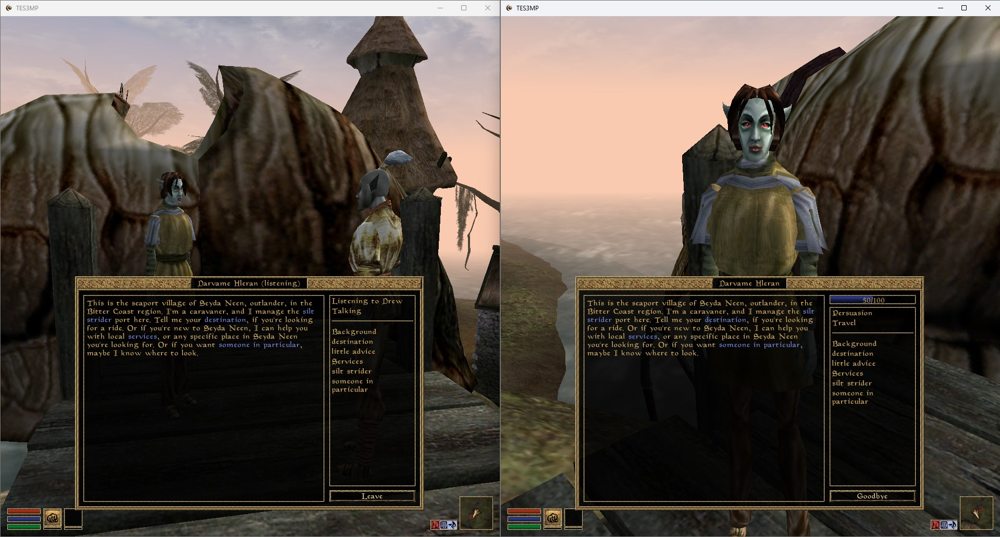

# TES3MP Shared Dialogue

[TES3MP](https://github.com/TES3MP/TES3MP) fork that lets nearby
players follow the same NPC conversation in Morrowind. One player talks and everyone
nearby sees the full dialogue as it happens, including blue keywords and available
topics, without advancing the conversation or repeating its quest scripts.

Based on TES3MP **0.8.1 / OpenMW 0.47.0**. The planned first public version is **0.1.0**,
targeting Windows x64. This is a client and server engine modification, not an
ESP or a server-only Lua mod.



The spectator can read and scroll both panels; only the speaker can advance the dialogue.

## Download and install

Use this repository's **[Releases](../../releases)** page for published downloads.
Before the first release is published, follow the [build guide](docs/shared-dialogue/building.md).
GitHub's automatic **Source code** downloads are for building the project; they
are not playable installations.

| Package | Who needs it? |
| --- | --- |
| `tes3mp-shared-dialogue-0.1.0-windows-x64-client.zip` | Every joining player |
| `tes3mp-shared-dialogue-0.1.0-windows-x64-client-server.zip` | The host, including their client |
| `tes3mp-shared-dialogue-0.1.0-sources.zip` | Source and build materials for developers and redistributors |

The Windows build uses [FFmpeg](https://ffmpeg.org) under the LGPLv2.1 or later.
Its matching source is included in the `sources.zip` asset on the same
[Releases](../../releases) page. See the [dependency inventory](THIRD-PARTY-NOTICES.md).

These are upgrades for an existing **TES3MP 0.8.1 Windows x64** installation.
Close the game and server, back up that installation, and extract the appropriate
ZIP beside `tes3mp.exe`. Keep supplied subfolders intact. Every player needs the
matching client, and the host needs the matching server. Stock TES3MP clients
and servers cannot participate in this fork's protocol.

See [installation and rollback](docs/shared-dialogue/installation.md) before
upgrading a campaign. Game files, accounts, saves and personal configuration are
not included. Players need their own Morrowind installation and the server's
required content/mod list.

## What changes

- Opening a conversation automatically opens a spectator window for available
  players in the same cell within **420 world units of the NPC**.
- Spectators see the full conversation, blue keywords, answer choices and the
  speaker's current topic list. They can scroll the transcript and topic list
  independently; only the speaker can select a topic or answer.
- Spectators can leave at any time. Activate the same NPC to rejoin while the
  speaker is still talking, with the complete current history restored.
- An NPC already in a conversation admits additional players as spectators.
- Barter, travel, enchanting and other services display an activity status for
  listeners while the speaker uses the normal service window.
- Goodbye, cell changes, death and disconnect clean up the relevant sessions.
  A spectator leaving does not end the speaker's conversation.

Automatic invitations are skipped while a player is already in another menu
or conversation. They can activate the NPC to join later. Voice audio and service
contents are not streamed. Journal sharing remains controlled by server scripts.

## Configuration

The server can change the radius with:

```ini
[Dialogue]
radius = 420
```

An explicit existing value overrides the default. See
[configuration and compatibility](docs/shared-dialogue/configuration.md) for
file locations, custom server scripts and protocol details.

## Development and support

- [Build from source](docs/shared-dialogue/building.md)
- [Implementation](docs/shared-dialogue/architecture.md)
- [Testing status and limitations](docs/shared-dialogue/testing.md)
- [Shared Dialogue changelog](docs/shared-dialogue/changelog.md)
- [Contributing and reporting bugs](CONTRIBUTING.md)
- [Release preparation](docs/shared-dialogue/releasing.md)

Report Shared Dialogue issues in **this fork's issue tracker**. Include the
client/server version, server scripts and mods, and steps to reproduce.

## Credits and license

Copyright (c) 2008-2015, OpenMW Team.

Copyright (c) 2016-2022, David Cernat & Stanislav Zhukov.

TES3MP Shared Dialogue builds on the work of the [TES3MP team](tes3mp-credits.md)
and [OpenMW contributors](AUTHORS.md). It is independently maintained and is not
an official release or endorsement by either project or Bethesda Softworks.
The original introduction is retained in [README.upstream.md](README.upstream.md).

The existing [GPLv3 license with TES3MP's additional terms](LICENSE) is preserved.
See [third-party notices](THIRD-PARTY-NOTICES.md) for dependencies. Morrowind game
assets belong to their respective rights holders. Game data needed to play is not
distributed here; the screenshot demonstrates the interface.
